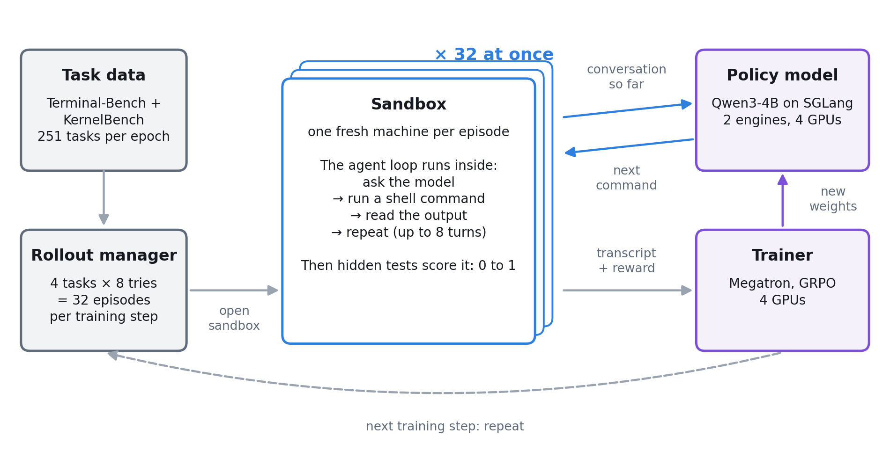
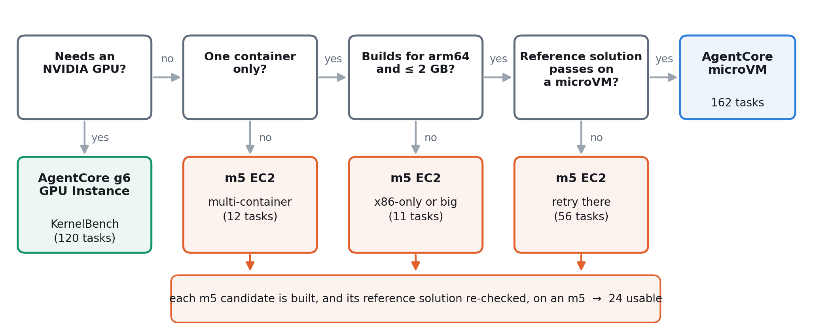
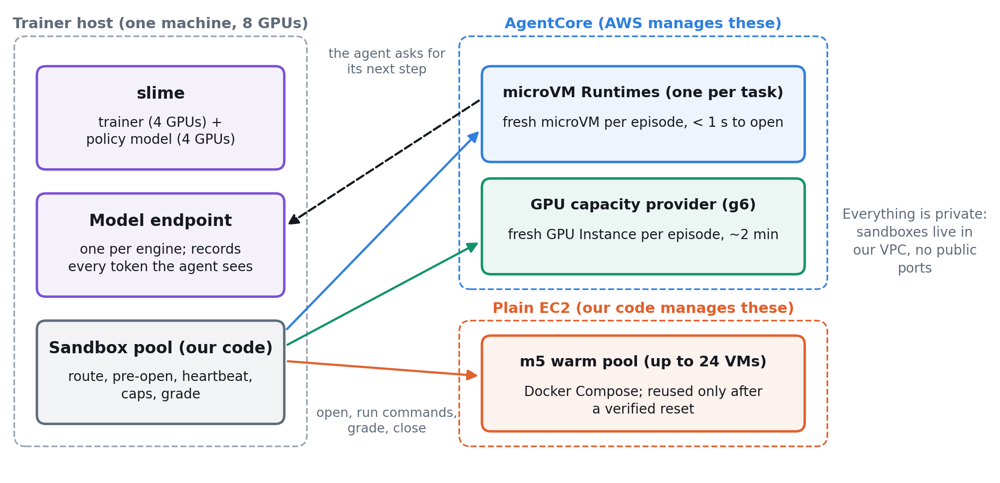
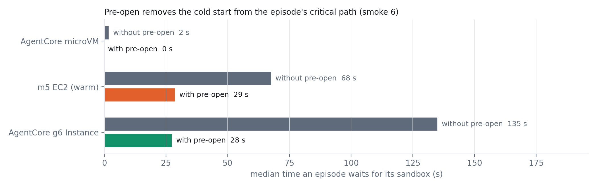
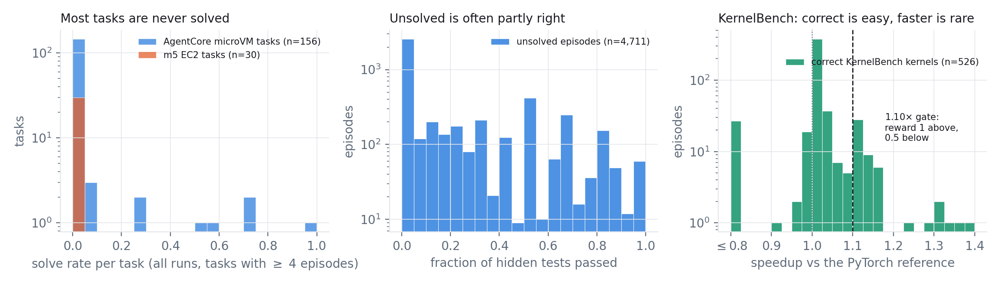
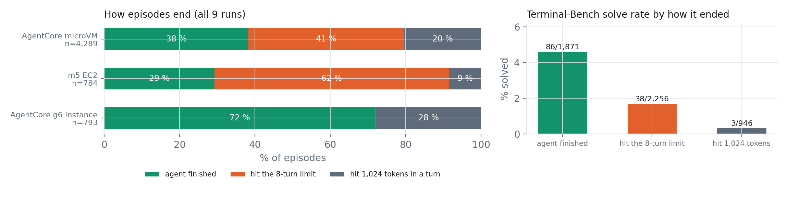
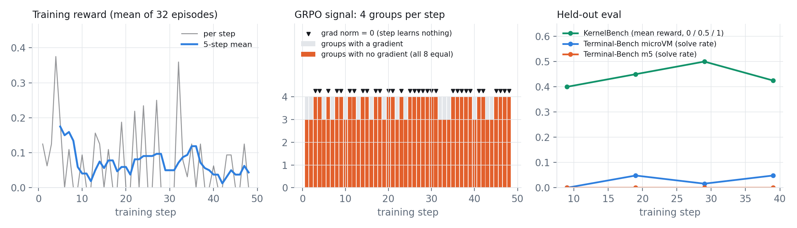
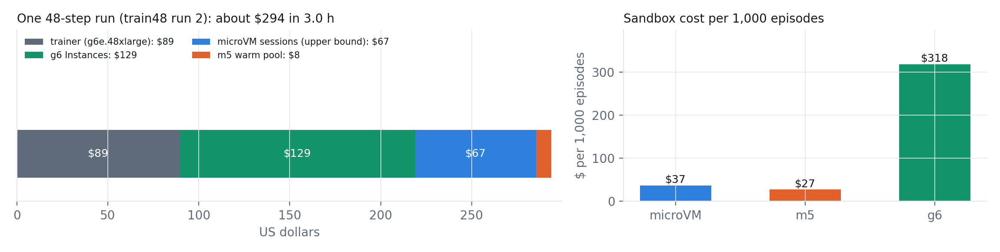

# Giving every AI agent its own computer: RL sandboxes on AWS for Terminal-Bench and KernelBench

*How we trained a small model on 300+ real shell and GPU tasks, why no single sandbox product could run them all, and what we learned along the way.*

---

## The short version

We wanted to teach a language model to **work in a real computer**: type shell commands, read what comes back, fix things, and try again. The way to teach that is reinforcement learning (RL): let the model attempt a task many times, score each attempt, and nudge the model toward what scored well.

The hard part turned out to be the computers, not the training. Every attempt needs **its own fresh machine**, set up exactly as the task describes, thrown away afterwards, and ready quickly enough that the expensive GPU trainer never sits idle.

We built this on AWS with three kinds of machine:

- **Amazon Bedrock AgentCore microVMs** for most tasks: fully managed and under a second to open.
- **Plain EC2 virtual machines (m5)** for tasks that need Docker, several containers, x86 or large images.
- **AgentCore GPU Instances (g6)** for tasks that need an NVIDIA GPU.

What we got:

- **186 of 241 Terminal-Bench tasks and all 120 KernelBench tasks** run, against 162 on microVMs alone.
- **0.6 % infrastructure errors** across 6,049 attempts.
- A full 48-step training run took **3 hours and cost about $294**.

The honest bit: the infrastructure works, but **the model has not visibly improved yet.** The bottleneck has moved from the sandboxes to the reward signal, and that is the next problem to solve.

---

## 1. What "agentic RL" means, in one picture

*One training step: 32 attempts run at once, each in its own sandbox.*

Here is one **training step**, in plain words:

1. **Pick tasks.** We take 4 tasks and try each one 8 times, which gives 32 **episodes** (attempts).
2. **Give each episode a machine.** Each of the 32 gets a brand-new **sandbox**: a small computer set up the way the task describes.
3. **Let the agent work.** A small agent program runs *inside* the sandbox. Each turn it sends the conversation so far to the model (Qwen3-4B) and gets back the next command, for example `ls` or `chmod +x run.sh`. It runs the command, reads the output and repeats, for up to 8 turns.
4. **Grade it.** When the agent stops, we copy in the task's **hidden tests** and run them. The result is a reward from 0 to 1. No AI judge is involved: the tests decide.
5. **Learn.** The trainer compares the 8 tries of each task. Tries that did better than their siblings get reinforced and tries that did worse get discouraged. This is GRPO (Group Relative Policy Optimization). One consequence matters later: **if all 8 tries score the same, there is nothing to learn from that task.**
6. **Repeat**, with the updated model.

The trainer is [slime](https://github.com/THUDM/slime), an open-source RL framework, running on one machine with 8 GPUs: 4 for training and 4 for serving the model. We didn't change slime's code. Everything in this post plugs in through its configuration hooks.

---

## 2. The two workloads

### Terminal-Bench: 241 small broken computers

[Terminal-Bench](https://github.com/laude-institute/terminal-bench) is a set of tasks an agent must solve **through a shell**. Each task comes with:

- an instruction ("this script won't run, fix it"),
- a Dockerfile that builds its environment,
- hidden pytest tests, and
- a reference solution, which proves the task can be solved.

Tasks range from easy to very hard:

| Task | What the agent must do | How our model did |
|---|---|---|
| fix-permissions (easy) | Notice the missing execute bit, `chmod +x`, run the script | solved 62 % of the time |
| postgres-csv-clean (hard) | Load a CSV into a Postgres container, clean it with SQL, export it; 14 hidden tests | never solved |

### KernelBench: beat PyTorch on a real GPU

[KernelBench](https://github.com/ScalingIntelligence/KernelBench) gives the agent a PyTorch model and asks for a faster version that gives the same answers. That needs a real NVIDIA GPU, which no Terminal-Bench task does. We used all 100 level-1 tasks (single operations) for training and all 20 level-2 tasks (fused operations) for evaluation.

- correct **and** at least 1.10× faster → reward **1**
- correct but not faster → **0.5**
- wrong or crashed → **0**

---

## 3. Why one sandbox product isn't enough

AgentCore Runtime is a managed service for running agent code. You hand it a container image and every new **session** gets its own isolated microVM, destroyed when the session ends. That is exactly what RL needs: one session per episode, a clean machine each time and nothing to clean up yourself. Most tasks run there.

Some tasks don't fit:

| What the task needs | Why a microVM can't do it | Tasks |
|---|---|---|
| Several containers, e.g. an app plus a Postgres database | no Docker daemon inside | 12 |
| An image larger than 2 GB | 2 GB image limit | 4 |
| x86 software | microVMs are arm64 only | 7 |
| Root-level system changes | all Linux capabilities are dropped | many of the 53 whose reference solution failed |
| An NVIDIA GPU | GPUs only exist on AgentCore *Instances* | all of KernelBench |

So we added two more kinds of sandbox:

- **m5 EC2 VMs** with Docker. This is how Terminal-Bench runs upstream: any architecture, any image size, root access, several containers. The cost is that **we** have to launch, reset and terminate them.
- **AgentCore g6 GPU Instances** through a *capacity provider*, which is AgentCore running real EC2 GPU machines for you. The KernelBench image is small and needs nothing but a GPU, so AgentCore's model still fits, and the API is the same one we use for microVMs.

The rule we ended up with: **use the managed microVM wherever the task fits, an AgentCore Instance when the task only needs bigger hardware, and plain EC2 only when the task needs a whole machine with Docker and root.**

---

## 4. Routing: let the data decide

We didn't guess which task goes where. Every task is **measured**: does it build for arm64, how big is the image, and does its own reference solution pass on that kind of machine?

*Four questions route each task. Every answer comes from a build log or a test run.*

The last check is the important one. **A task is used for training only if its reference solution passes and the untouched environment fails.** Otherwise the reward means nothing: either nobody can ever score, or everybody scores for doing nothing.

Of the 55 Terminal-Bench tasks we dropped, 48 fail their *own* reference solution, mostly because something upstream moved: a deleted GitHub repo, a dead download link, a package version that drifted. Seven are a bug on our side that we still have to fix.

---

## 5. The architecture

*One trainer, three kinds of sandbox. AgentCore manages two of them and our code manages the third.*

Three design choices keep this simple.

**1. One code path for training.** The agent loop, the grader, the reward and the metrics don't know which kind of machine they are on. Every sandbox runs the same small HTTP wrapper with four operations: run a command, write a file, read a file, upload files. AgentCore delivers those calls to microVMs and g6s, and on an m5 we send them over plain HTTP.

**2. The agent lives inside the sandbox.** Commands run locally inside the sandbox, and only the request for the next turn crosses the network, back to a model endpoint on the trainer. That endpoint also records every token the model produces, which is what the trainer learns from.

**3. Everything is private.** Sandboxes run inside our VPC with no public ports. Only security-group rules let them reach the trainer, and the sandboxes hold no useful credentials. This matters because the code running inside them was written by a model that is still learning.

### Swapping in a different agent

The default agent is a small loop we wrote that mimics Claude Code's three tools (`bash`, `write_file`, `read_file`). We also wanted to train with **real agent programs**, so the model learns the task rather than one agent's quirks. The demo can now spread episodes across three "harnesses" (the program that drives the agent):

| Harness | Where it runs | Machines per episode |
|---|---|---|
| our small loop (the default) | inside the sandbox | 1 |
| the real **Claude Code CLI** | its own AgentCore session, driving the sandbox remotely | 2 |
| our small loop, run the same remote way | its own AgentCore session | 2 |

In an 88-episode test on AWS all three ran, called tools and were graded. The real CLI is a much busier agent, making 5 to 97 tool calls per episode against about 8 for our loop. That makes it slower (40 to 110 s per episode) and it needs a second microVM. It's off by default (`HARNESS_SET`). The payoff we're after, a model that copes with an agent program it never trained with, needs a longer run to show.

---

## 6. Making it fast: pre-open

Opening a sandbox takes time. Median "cold start" times from our 48-step run:

| Sandbox | Time to open (median) |
|---|---|
| AgentCore microVM | **0.7 s** |
| m5 EC2 (launching a new VM) | **33 s** |
| AgentCore g6 GPU Instance | **133 s** (boot plus installing CUDA PyTorch) |

A typical episode spends about **16 seconds** working, so a g6 takes as long to boot as 8 whole episodes. If every episode waited for its own machine, the GPUs would sit idle most of the time.

**The fix is pre-opening.** Training data is a queue, so we already know which tasks come next. While the current batch runs, we boot sandboxes for the next 2 batches (5 batches for the slow m5 and g6). By the time an episode starts, its machine is usually already up.

*Pre-open cut the median wait on GPU sandboxes from 135 s to 28 s, saving about 80 minutes of waiting in one short run.*

Two smaller lessons from this:

- **Caps must leave room for the look-ahead.** With the GPU session cap set to 8 (one task's worth of tries), nothing could open early and the median wait was 240 s. At 32 it dropped to 28 s.
- **Idle sandboxes get reclaimed.** AgentCore ends sessions that sit idle for 15 minutes. A small **heartbeat** pings pre-opened sessions every 7.5 minutes so they survive until they're used.

---

## 7. Making the reward honest

A reward is only useful if it measures what you meant. We hit three problems.

**Problem 1: the agent can see the answers.** If the tests are on the machine, the agent can read them. The tests and reference solutions never go into an image. They are copied in **only after the agent has stopped**, and the KernelBench checker uses a random file name and a one-time code in its "PASSED" line.

**Problem 2: the reward can be gamed.** Our first KernelBench reward only checked that the answers matched. Simply copying the original PyTorch code onto the GPU "passed", and **64 % of episodes scored full marks without any speedup.** Adding the speedup gate fixed it: of 526 correct kernels, only **50 (9.5 %)** were really 1.10× faster.

*Left: most tasks are never solved. Middle: but unsolved attempts are often partly right. Right: on KernelBench, "correct" is easy and "faster" is rare.*

**Problem 3: all-or-nothing scores give no signal.** This is the big one. **143 of 156** microVM tasks and **all 30** m5 tasks were never solved in any run. A task that is never solved gives 8 zeros, and as we saw in Section 1, 8 equal scores teach the model nothing.

The middle chart shows a way out: **46 % of unsolved attempts passed at least one hidden test.** So in training we now give **partial credit**, half a point times the fraction of tests passed. Evaluation stays strict pass/fail.

---

## 8. Why attempts fail: they run out of turns

*41 % of microVM attempts and 62 % of m5 attempts hit the 8-turn limit before the agent was done.*

When the agent decides it is done, it solves the task **4.6 %** of the time. When the 8-turn limit cuts it off, only **1.7 %**. Multi-container m5 tasks (start a service, configure it, test it) need more turns. And **28 %** of KernelBench attempts ran out of the 1,024 tokens allowed per turn while still writing the kernel.

The obvious next experiment is a bigger budget. The cost is that each episode takes longer and uses more sandbox and GPU time.

---

## 9. Results: the infrastructure works, learning isn't there yet

**Reliability.** Over 9 runs and **6,049 episodes** there were **38 infrastructure errors (0.6 %)**, mostly test runs that timed out on two heavy tasks. In the 48-step run, 129 m5 VMs served 407 episodes between them, each reused only after a verified clean reset, and none were left running afterwards.

**Learning.** Our cleanest run finished all 48 steps in 2 h 58 min. The training curves are flat:

*In 32 of 48 steps, every group of 8 tries scored the same, so the model learned nothing from that step.*

In **176 of 192** task groups all 8 tries scored the same. The model was solving almost nothing (or, on KernelBench, scoring the same 0.5 every time), so GRPO had no differences to learn from. That run used all-or-nothing rewards. The partial-credit runs from Section 7 are the next result to look at.

We report this plainly because it is the most useful lesson in the project: **once the sandboxes are solved, the reward becomes the limit on learning.**

---

## 10. What it costs

*About $6 per training step. GPU sandboxes cost about 10× more per episode than CPU ones.*

- **The whole run cost about $294**, roughly $6 per training step, for about 2,500 episodes.
- **GPU sandboxes dominate.** Each g6 boots for about 2 minutes and then stays up for 10 minutes after its session ends before the capacity provider shuts it down. An instance's median lifetime was **15 minutes for a 3-minute session.** Hosting the CUDA wheel in S3 and using fewer, longer GPU sessions are the clear savings.
- **The microVM figure is an upper bound.** AgentCore bills for active CPU and memory actually used, and we priced every session as fully busy.
- **Throughput:** about **845 episodes per hour** with 32 running at once. The first limit to scaling is model inference (more GPUs), not the sandboxes: AgentCore allows 5,000 live sessions and we peaked under 200.

---

## 11. Five lessons if you're building this yourself

1. **Treat the sandbox as the environment.** In gym terms, `reset()` opens a fresh machine, `step()` runs a command in it, the reward comes from hidden tests and `close()` destroys it. Use one machine per episode, and only reuse one after a verified reset.
2. **Route tasks with data, not judgment.** Build every task, measure it and run its reference solution on the target machine. Drop tasks whose own solution fails, or you'll train on noise.
3. **Hide cold starts.** You know which tasks come next, so boot their machines early. Look further ahead for slow machines, and size your caps to include the look-ahead.
4. **Distrust your reward.** Hide the tests until the end, and check that "doing nothing clever" can't score. Our speedup gate removed a hack that was scoring 64 % of episodes.
5. **Watch for "no gradient".** If every try in a group scores the same, the step teaches nothing. Track that number (gradient norm = 0) rather than the loss, and add partial credit or a curriculum of tasks the model sometimes solves.

---

## What's next

- **Partial-credit training** on the full task set, to see whether more groups carry a learning signal and the evaluation score moves.
- **A curriculum** of sometimes-solved tasks: in the 48-step run, all 42 microVM solves (out of 1,795 attempts) came from just 10 tasks.
- **Faster GPU sandboxes.** Today every g6 downloads and installs CUDA PyTorch from the PyTorch package index each time it boots, which is most of its 2-minute start. Serving the wheel from S3, or baking it into the image, should cut that.
- **Show that training across agent programs pays off.** The plumbing works (see "Swapping in a different agent" in Section 5). The open question is whether a model trained with several harnesses does better on one it has never seen.

*A note on benchmark hygiene: Terminal-Bench asks that its data not appear in training corpora. A model trained on these tasks no longer has a comparable public Terminal-Bench score, so report only held-out tasks, and use your own task set for production training. The pipeline accepts any task in Terminal-Bench format.*

---

*All numbers are from runs in us-west-2 between 4 and 9 October 2026. Model: Qwen3-4B. Trainer: slime with fully-async GRPO on a single g6e.48xlarge.*
