# AgentCore as the Sandbox in Agentic RL

**Kaige Yang** — Senior Applied Scientist, 亚马逊云科技 (AWS)

September 10, 2026

---


## Purpose — a practitioner's guide to AgentCore as an RL sandbox

This deck is a **hands-on guide for AWS customers doing agentic RL**. It is grounded in a working **slime + AgentCore** project and in the **official AgentCore docs** [D1], and everything shown is exercised by runnable demos with measured results.

**After it, you will know:**

- **What AgentCore can and cannot do** as an RL sandbox (and, optionally, as the harness host).
- **How to wire it into a trainer** — one `generate` hook into slime, no fork.
- **How to build and customize** a Runtime — CPU (Code Interpreter microVM) and GPU (Instances).
- **What it costs and what it proves** — lifecycle, latency, scaling, and 13 demos of measured evidence.

**One thesis.** In agentic RL the loop has two execution seams — the **harness** (the agent loop) and the **sandbox** (where untrusted model output runs and the reward is computed). This project keeps the harness **in-process** and puts **AgentCore in the sandbox seam**; the only thing that varies across all 13 demos is the *sandbox substrate* and the *task*.

# 1 · The problem and the thesis

## The agentic-RL loop — and the two seams AgentCore fills

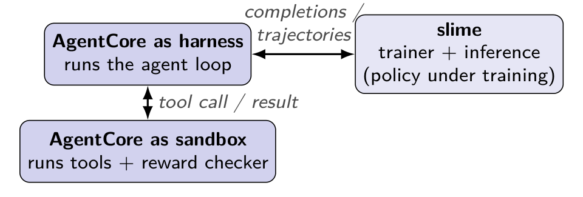{ width=82% }

A rollout is a multi-turn **act → observe → revise** loop: the policy proposes an action, the **sandbox** executes it and returns an observation, and a **checker** in the sandbox produces the reward. The **harness** owns that loop; the **trainer** (slime) consumes the resulting samples. AgentCore can serve **either** seam — this project uses it as the **sandbox**.

## Thesis — one design, vary only substrate + task

Policy is always **Qwen3-4B**, trained by **slime**, harness **in-process**, **AgentCore the sandbox**. Across the whole demo set, only two things change: the **sandbox substrate** (CPU microVM vs GPU Runtime instance) and the **task**. *Identical loop code CPU vs GPU — only the sandbox ARN differs.*

| | CPU sandbox — MBPP | GPU sandbox — KernelBench |
|---|---|---|
| in-process harness | `demo_cpu_datasets` (`DATASET=mbpp`) | `demo_gpu_single` |

**13 demos on this one design** (9 CPU + 4 GPU), in three layers: **5 canonical** anchors — one of them, `demo_cpu_datasets`, trains any of ~19 RLVR datasets via a `DATASET=` selector (it replaces the ten former per-dataset folders), and `demo_gpu_farm` picks its GPU split via `FARM=fractional|whole` (it replaces `demo_gpu_shared_single`/`_multi`/`demo_gpu_local`) · **2** that scale a new dimension (harness / mixed-family batch) · **6 substrate-and-design variants**. The rest of the deck walks the architecture, the AgentCore mechanics, and then these demos with numbers.

# 2 · Agentic-RL reference architecture

## The harness — the agent loop that owns the episode

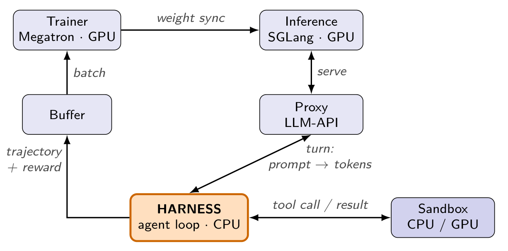{ width=72% }

The harness opens the episode, calls the policy turn by turn, routes each action to the sandbox, feeds the observation back, runs the checker, and packs the outcome into a training `Sample`. It is the **only component that sees a whole episode** — which makes it the place that stamps reward, grouping, and loss mask.

## The proxy & TITO — every model call is the policy under training

Every model turn goes through a **proxy** (`AnthropicAdapter`) that fronts SGLang, so each call is the *policy being trained*, not some external model. Its core job is **token-in-token-out (TITO)**: record the **exact `token_ids` + logprobs the policy sampled**, with **no re-tokenization** on the way back into the trajectory.

- Get TITO wrong and you train on tokens the policy never emitted — silently off-policy, biased gradients.
- TITO removes the *tokenization* half of the train/inference mismatch; the *numeric* half (engine vs trainer kernels) is what Truncated Importance Sampling would address later (§7).

## When one episode becomes many samples — branching

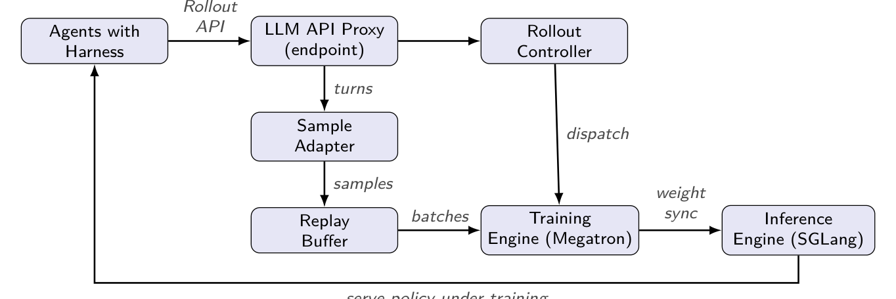{ width=70% }

One episode can fan out into a **dynamic number** of samples $N_\rho$ — via **context summarization** (rewrites the prefix), **response rewriting** (tool-call/JSON repair), or **subagents** (own call chains). In Agent Lightning only **36%** of rollouts stay a single sample; the mean is **2.4** [1]. The harness stamps every fragment with a shared `rollout_id`; training honours the grouping for advantage + loss. (`demo_cpu_branching` exercises this with the real Claude Code CLI.)

## slime — the trainer and its asynchronous rollout

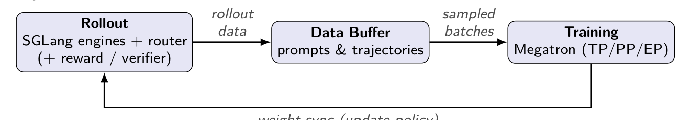{ width=72% }

**slime** (THUDM) [9] = **Megatron** (training) + **SGLang** (rollout) behind a **router**, bridged by a **Data Buffer**. Agentic workloads plug in as a **custom rollout-generation hook** — where our harness + AgentCore sandbox live — with **no fork of the training kernel**. Megatron periodically pushes updated weights to the SGLang servers; rollout and training run **async/decoupled** (`MODE=B` fully-async here).

## Scaling the loop — throughput = min(inference, sandbox, harness)

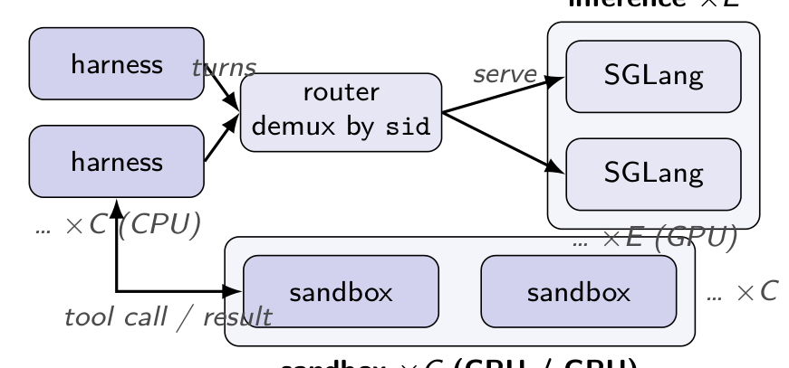{ width=64% }

Rollout throughput = **`min(inference, sandbox, harness)`** — scale two and the bottleneck just moves. So **diagnose first**, using the harness's own metrics (`perf/sglang_gen_ms_*` vs `perf/sandbox_ms_*`):

- **Generation dominates** ⇒ **inference-bound**: add SGLang replicas / GPUs, not sandboxes (e.g. long-reasoning math — checker is a 1-line assert).
- **Sandbox dominates** ⇒ **sandbox-bound**: add sandbox concurrency / instances (e.g. KernelBench — `nvcc` + `allclose` take seconds).

# 3 · The tasks that run in the sandbox

## What frontier labs run — RLVR against verifiable envs

Frontier models train with **RL against executable, verifiable environments**. **Common denominator:** untrusted output runs in an isolated sandbox; a checker produces the reward — exactly the sandbox seam.

| Model | Sandbox / verifier | Tasks | Reward |
|---|---|---|---|
| DeepSeek-R1 [2] | code compiler + rule verifier | math, competitive code | tests pass / answer match |
| Qwen3 [3] | RLVR verifiers + live tool/agent env | math, code, tool-use, RAG | rule + model-judge (w/ ref) |
| Llama-Nemotron [4] | **LLM-judge, no code exec** | math, science, instruction | answer-match + format |
| Kimi K2 [5] | simulated tool-use envs + verifiers | agentic tool use, math, code | verifiable rewards |

## The task zoo — 11 families, one harness

One **task-agnostic** harness; each family changes only **prompt + seed files + checker** (`task_families.py`). All **RLVR** — binary **1.0/0.0** from a checker, no LLM judge. **87 seeds** across ten families + MBPP/KernelBench; select with `FAMILY=sql`, dispatch by `metadata.task.family`.

| Family | Seed files | Checker |
|---|---|---|
| coding (MBPP/KernelBench) | — | hidden asserts / allclose on cuda |
| swe | — | assert suite green |
| tool_use | `tools.py` | result==gold ∧ tools called |
| sql | → `query.sql` | result-set == gold (SQLite) |
| math · ctf | — | `|ans−gold|≤1e-6` · `check(flag)` |
| rag | `docs/*.txt` | answer == grounded fact |
| regex · planning · config · data | (varies) | POS/¬NEG · `verify()` · constraints · `output==gold` |

## The task→sandbox pattern — seed, run, check, reward

`run_episode` (`harness.py`) is family-agnostic — the same loop for all 11 families:

```python
for name, content in task.setup_files():
    await sandbox.write_file(name, content)
await sandbox.write_file("run_checks.py", task.runner_source())
for _ in range(task.max_turns):
    text = await policy.complete(messages)                 # model turn (via proxy)
    code = task.extract_submission(text)                   # fenced block
    await sandbox.write_file(task.artifact_filename, code) # solution.py / query.sql
    exit_code, out, err = await sandbox.exec("python3 run_checks.py", timeout=60)
    if exit_code == 0: solved = True; break
    messages.append(task.observation(exit_code, out, err)) # feed failure back
reward = task.reward(0 if solved else 1)                   # 1.0 / 0.0
```

**The checker runs *inside* the sandbox — the microVM is the reward source.**

## Datasets — build once, seed per episode

Builders (`demos/demo_cpu_datasets/`): `build_dataset.py` (MBPP/KernelBench) and `build_family_datasets.py` (ten families, `--eval-frac 0.25`). Uniform row schema:

```json
{"prompt": "…task text…", "label": "mbpp_601",
 "metadata": {"task": {"family": "sql", "task_id": "…",
                       "spec": {"schema": ["…"], "expected": [["…"]]}}}}
```

- **Real splits:** MBPP 500/8, KernelBench 100/20, families ≈ 4–12 train each (87 seeds).
- `generate.py` rebuilds the Task, seeds the workspace, runs the checker, emits a **loss-masked slime `Sample`** (mask 0 on prompt/observation/tool tokens, 1 on the policy's own tokens).
- Reference answers (`mock_attempts`) are **dropped** from rows so they can't leak into prompts.

# 4 · Foundations of AgentCore Runtime

## AgentCore basics — services, and can / cannot

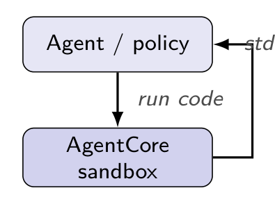{ width=44% }

- **Runtime** — serverless, **per-session microVM** (isolated CPU/mem/FS); invoke via `InvokeAgentRuntime` (SigV4) [D2, D8].
- **Code Interpreter** — isolated CPU sandbox; **Python/JS/TS** [D6]. **Browser · Gateway (APIs→MCP) · Memory · Identity · Observability (OTEL)** [D13].
- **Cannot (per docs):** microVM has **no GPU** — GPU only on **Instances** [D5]; **no cross-session GPU time-slicing**; session caps (microVM 8 h) [D3]; VPC-mode needs endpoints wired up [D11].

## The microVM & the two compute types

AgentCore Runtime offers **two substrates**, chosen at create time; the loop code is identical across them.

| | **microVM** (serverless / CPU) | **Instances** (GPU EC2 via capacity provider) |
|---|---|---|
| Compute | Firecracker-class, own guest kernel, **CPU-only** | `g4dn/g5/g6/g6e/g7e/…` — **GPU** |
| Arch / image cap | **ARM64**, ~**2 GB** | **amd64**, instance root disk |
| Cold start | **~1–2 s** | **~60–80 s** (EC2 cold-launch) |
| Session length | up to **8 h** (15-min idle) | up to **14 days**; persistent EBS |
| Reuse policy | fresh microVM per episode (cheap) | **warm-instance reuse** (shared session) |

There is **no general-purpose CPU Instance family** — the Instances substrate exists to add a GPU. A large *CPU* image past the 2 GB cap runs on a GPU-family Instance with the GPU idle (`demo_cpu_bigimage`, `m5`-style capacity provider).

## Runtime / session / microVM — three concepts (1 : N : 1)

{ width=64% }

- **Runtime** = a stateless *template*: one image, one ARN.
- **Session** = one `runtimeSessionId` (≥33 chars); the first invoke under a fresh id **cold-starts** its own microVM; same id re-routes to the warm VM.
- **Cardinality:** one Runtime serves **many** concurrent sessions, each mapped to **exactly one** microVM → **1 : N : 1**. The number of Runtimes tracks distinct **images** (capabilities), not tasks — a mixed-family run stays on **one Runtime, many sessions**.

## Lifecycle & latency — launch → invoke → terminate

- **Launch.** No "create session" API — the first `InvokeAgentRuntime` under a new `runtimeSessionId` provisions the compute (a microVM, or a **cold-launched EC2** on Instances) [D2].
- **Terminate.** Auto on **idle (15 min, resets per invoke)**, **max lifetime** (microVM **8 h**; Instances **14 d**), or unhealthy → microVM terminated + **memory sanitized** [D3, D4]. Explicit `StopRuntimeSession` [D12].
- **Latency.** Docs promise "fast cold starts" but publish **no number** [D2]; a GPU first-invoke can cold-launch in **minutes**. So **measure it**: the sandbox emits `[sbx-op]` per round-trip and `[sglang-gen]` per generation → `perf/sandbox_ms_{p50,p95}` & `perf/sglang_gen_ms_*`.

## Build & deploy a custom Runtime — the how-to

One driver: `deploy/deploy_two_runtime.py`. Managed microVM runtimes must be **arm64**; the GPU capacity provider is **amd64**.

```bash
export AWS_REGION=us-west-2
python3 deploy_two_runtime.py all      # ECR create + buildx cross-build + push + create runtimes
```

**Steps:** (1) ECR create + `docker buildx --platform` cross-build + push; (2) `CreateAgentRuntime` with `containerConfiguration` [D9]; (3) for GPU, `CreateCapacityProvider` (`ec2Configuration`: `g6.xlarge`, VPC subnets/SGs, EBS, `idleInstanceTimeout=600`, `maxLifetime=86400`) then attach via `capacityProviderConfiguration` [D5, D9].

**IAM:** `acs-exec-role` (ECR pull, logs, `InvokeAgentRuntime`) + `acs-operator-role`. **Customize** = edit `sandbox_server_agent.py` — a `BedrockAgentCoreApp` with `@app.entrypoint`.

# 5 · Wiring AgentCore into slime

## slime integration — hooks, not a fork

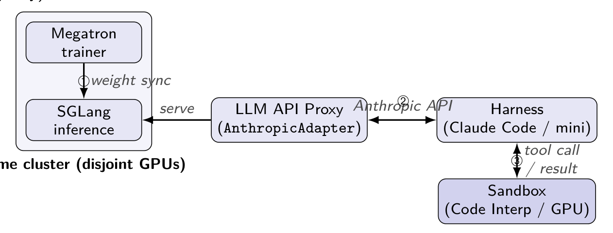{ width=70% }

slime drops AgentCore into **two hooks — no fork**:

- `--custom-generate-function-path` → `generate.generate` (drives the harness, records turns).
- `--custom-rm-path` → the reward.

Each tool call is `invoke_agent_runtime(ARN, session_id)` (SigV4); boto3's sync call is offloaded via `asyncio.to_thread`, so **N episodes run concurrently**; **one session = one episode**. Bound episode cost with `EPISODE_MAX_TURNS` (default 3).

## The call path — one diagram

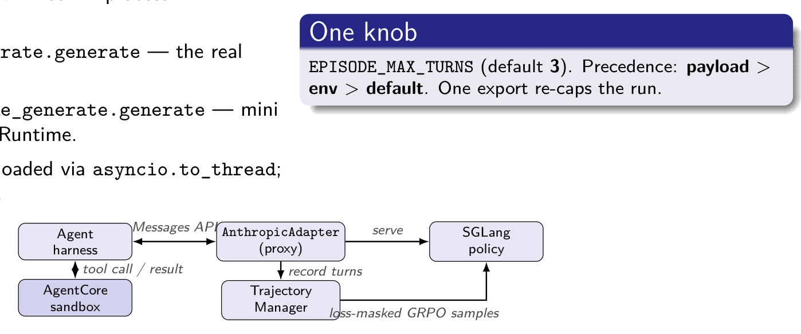{ width=58% }

```python
async def generate(args, sample, sampling_params):        # slime hook
    task = task_from_dict(sample.metadata["task"])
    async with make_sandbox("agentcore-runtime") as sb:   # -> AgentCoreRuntimeSandbox
        traj = await run_episode(task, policy, sb)        # seed/turn/check loop
    return build_token_stream(traj, sample)               # loss-masked Sample

def _invoke(self, op, **kw):                               # 1 op = 1 invoke
    body = json.dumps({"op": op, "session_id": self.session_id, **kw})
    r = self._rt.invoke_agent_runtime(agentRuntimeArn=self.arn,
        runtimeSessionId=self.session_id, payload=body)
    return json.loads(r["response"].read())               # {"exit_code","stdout",...}
```

## CPU sandbox — Code Interpreter (the default)

Serverless CPU microVM; **Python/JS/TS**; session default **900 s**, max 8 h [D6, D7]. Our `AgentCoreSandbox` wraps it (`writeFiles` / `executeCommand` / `readFiles`).

```dockerfile
FROM public.ecr.aws/docker/library/python:3.12-slim
RUN pip install --no-cache-dir bedrock-agentcore
COPY agentcore_slime_demo/sandbox_server_agent.py /app/
ENV SANDBOX_WORKDIR=/workspace
CMD ["python", "-m", "sandbox_server_agent"]
```

`SANDBOX=local` runs the *same* checker with no microVM — offline CI.

## GPU sandbox — Runtime on Instances (g6 / L4)

GPU lives on the **Instances** compute type (EC2 via a capacity provider); microVM GPU is "Not supported" [D5]. Sessions up to **14 days**. Use for **KernelBench** — write `ModelNew`, build+run on cuda, reward = allclose + speedup [7].

```dockerfile
FROM public.ecr.aws/docker/library/python:3.12-slim
RUN pip install --no-cache-dir bedrock-agentcore
COPY agentcore_slime_demo/sandbox_server_agent.py /app/
ENV LD_LIBRARY_PATH=/usr/lib64          # AgentCore injects libcuda.so.1 here
CMD ["sh","-c","pip install torch==2.5.1 --index-url .../cu124 \
                && exec python -m sandbox_server_agent"]
```

Torch is installed **at `CMD`, not baked** — the CUDA wheel exceeds the 2 GB image cap. **Why remote GPU:** untrusted CUDA never shares VRAM/host with training state; the checker's g6 is disposable.

## Episode-end teardown + warm-instance reuse

- **Teardown.** `run_episode` closes nothing itself; every caller wraps it in `async with make_sandbox(...) as sb:`, so `__aexit__` ends the session the instant the episode returns — one path, identical across all demos.
- **microVM:** boots in ~1–2 s → **deliberately not reused**; each episode mints its own fresh microVM (cheap, isolated for free).
- **Instances (CPU `m5` + GPU `g6`):** ~60–80 s cold boot → **warm-instance reuse**: all episodes share **one `runtimeSessionId`** (one warm instance, cold boot paid **once**) + a per-episode **`sub_session`** with a **fresh isolated env**. CPU farm isolates everything; GPU farm keeps the **CUDA kernel cache warm**.

## Can AgentCore host every frontier sandbox? — tick by tick

**Bottom line:** the only hard limit is GPU **sharing / fractioning** — not any missing capability. *Legend:* ✓ native · ◑ needs a BYO container / egress.

| Task / sandbox | ✓? | How — and the limit |
|---|---|---|
| Code exec + unit tests (DeepSeek, Qwen) [2,3] | ✓ | Code Interpreter, or your image on a Runtime |
| Math / logic verifier | ✓ | stdlib checker in the CPU microVM |
| Tool-use env (Kimi K2) [5] | ✓ | Python tools; MCP via Gateway |
| Per-repo Docker image (SWE) [6] | ◑ | your OCI image; microVM is **arm64-only, 2 GB cap** — slim it or use Instances |
| Browser / computer use | ✓ | managed Browser tool |
| Networked RAG / web read | ◑ | egress — public, or VPC + endpoints [D11] |
| GPU kernel / CUDA (KernelBench) [7] | ◑ | Instances only; 1 session = 1 GPU; **no MIG on L4** |

# 6 · Demos and measured results

## The demo set — one design, three layers, 13 demos

::: columns
:::: column
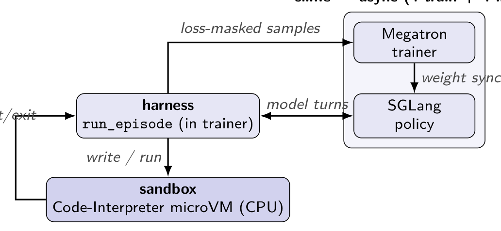{ width=100% }
::::
:::: column
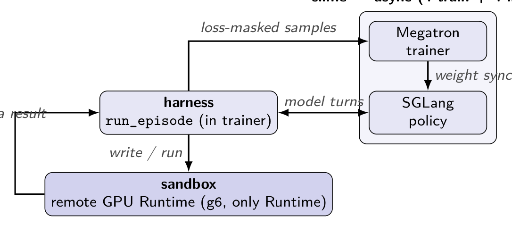{ width=100% }
::::
:::

Same harness both sides; **only the sandbox ARN differs**. Evidence tiering: **2** demos carry committed **convergence-shaped** curves (`demo_cpu_datasets` `DATASET=mbpp`, `demo_gpu_single`); the rest are **loop-verified 10-step hardware smokes** (`Job succeeded`, ckpt 10, real rewards) — **CPU: 6 demos, 15 runs (`demo_cpu_datasets` ×10 `DATASET=` values + 5 other CPU demos) + 6 GPU runs (4 GPU demos; `demo_gpu_farm` in both modes, `whole` twice) pass**. One caveat: `demo_cpu_branching` runs but earns reward 0.

## Demo set at a glance (1/2) — canonical + scale

| Demo | Substrate | Task | Result |
|---|---|---|---|
| *— canonical (5) —* | | | |
| `demo_cpu_datasets` | CPU microVM | `DATASET=` selector (default MBPP) | `mbpp` **trained** + ablation; `math` smoke 1.00 |
| `demo_gpu_single` | GPU g6 / local farm | KernelBench CUDA | **trained**; farm smoke 0.525 |
| `demo_gpu_farm` | GPU, local Ray farm (`FARM=`) | KernelBench CUDA | `fractional` (0.5+0.5, one GPU) smoke 0.775; `whole` (one GPU each) smokes 0.65 / 0.70 |
| `demo_cpu_heartbeat` | CPU microVM | heartbeat / quiesce | smoke 0.71; + offline probe |
| `demo_gpu_snapshot` | GPU, local farm | snapshot / resume | smoke 0.625; 3 files/ep saved+restored |
| *— scale a new dimension (2) —* | | | |
| `demo_cpu_scale_lanes` (was `harness_scale`) | CPU microVM | DeepScaleR (fixed); 4 × 4 × 4 lanes (4 harness workers : 4 TP1 SGLang engines : 4 persistent microVMs, 1:1:1) | reworked, offline-verified; earlier smoke 0.33 was the pre-rework single-engine topology |
| `demo_cpu_mixtask` | CPU microVM | mixed: math+SQL+CTF+tools | smoke, `eval/mixed` 0.67 |

## Demo set at a glance (2/2) — datasets + variants

| Demo | Substrate | Task | Result |
|---|---|---|---|
| *— `demo_cpu_datasets` real-HF `DATASET=` runs (not separate demos) —* | | | |
| `DATASET=gsm8k` | CPU microVM | GSM8K | smoke 0.90 |
| `DATASET=math500` | CPU microVM | MATH-500 | smoke 0.89 |
| `DATASET=deepscaler` | CPU microVM | DeepScaleR | smoke 0.78 |
| `DATASET=humaneval` | CPU microVM | HumanEval | smoke 0.85 |
| `DATASET=gretelsql` | CPU microVM | Gretel text-to-SQL | smoke 0.60 |
| `DATASET=hotpotqa` | CPU microVM | HotpotQA (multi-hop) | smoke 0.65 |
| `DATASET=xlam` | CPU microVM | xLAM-60k tool use | smoke 1.00 |
| `DATASET=mcp` | CPU microVM | ToolACE (MCP) | smoke 1.00 |
| *— substrate & design variants (6) —* | | | |
| `demo_cpu_branching` | CPU microVM (CLI) | SWE, **real Claude Code CLI** | smoke; fan-out ≥ 1, reward 0 |
| `demo_cpu_customruntime` | CPU microVM | DeepScaleR, both backends | smoke, `eval` 0.69 |
| `demo_cpu_imagepool` | CPU microVM (image pool) | datasci + scipy + sklearn | smoke 1.0; 3-image pool routed |
| `demo_cpu_terminalbench` | CPU microVM (~229-image pool) | Terminal-Bench, fresh microVM/episode, next 2 batches pre-opened (64 sessions, look-ahead data source) | 218/229 Runtimes deployed; oracle check 165 usable of 212 so far; no training run yet |
| `demo_gpu_customruntime` | GPU, custom g6 Runtime | KernelBench + CUDA probe | smoke 0.65 |
| `demo_cpu_bigimage` | CPU **Instance**, ~4 GB image | DeepScaleR math | **trained** on m5; warm-farm boots 201 → 1, `eval` 0.76 |

## Terminal-Bench look-ahead pre-open (1/2): status and why

**Status.** The look-ahead is built and passes two offline tests, but it hasn't run on AWS or in real training yet. With the defaults (4 prompts × 8 samples, 2 batches ahead), the pool keeps **64 microVMs booted ahead** of the episodes that are running.

**How the pool learns the next two batches' episodes.** slime would never tell it in time: it passes along only **8 episodes** of the current batch at once and doesn't draw the next batch until the current one finishes. But slime's prompt order is **predictable**: it walks a shuffled dataset in order, with a fixed seed for each epoch. So a data source can compute what slime will draw next.

## Terminal-Bench look-ahead pre-open (2/2): the five steps

1. A new **look-ahead data source** (`agentcore_slime_demo/tb_lookahead_source.py`, wired in `run.sh` with `--data-source-path`) wraps slime's normal one. Each time slime draws a batch, it also works out the prompts of the next 2 batches the same way slime will draw them, without moving slime's position.
2. It sends the pool the task list for each upcoming episode: the **32** just drawn, plus the next **64**.
3. The pool keeps the first **64** not-yet-started episodes booted, each on its own brand-new session on that task's Runtime. Sessions are matched by task, and each one still serves exactly one episode.
4. When a worker starts an episode, it takes a ready session for that task and the next episode in line starts booting. So 64 always stay booted ahead, which covers batch **N+2** before slime draws it. The existing heartbeat keeps waiting sessions alive.
5. If a prediction is wrong, the extra sessions are stopped at the next draw and those episodes just open on demand.

## Results — what's proven, read honestly

- **Two convergence-shaped curves.** `demo_cpu_datasets` `DATASET=mbpp` (CPU microVM) and `demo_gpu_single` (remote g6 GPU) — full 10-step runs with an eval curve; the MBPP run also carries an ablation sweep.
- **The rest are loop-verified smokes** — `NR=11` ⇒ 10 train steps + 1 held-out eval + final ckpt 10, real `invoke_agent_runtime` → `write_file`/`exec`/`read_file`, real rewards. **15 CPU smoke runs from 6 demos** (2026-09-18→19 batch; 10 of them `demo_cpu_datasets` `DATASET=` variants, run as separate folders before the merge) **+ 6 GPU runs** (2026-09-21 sweep; all 4 GPU demos, `demo_gpu_farm` in both `FARM` modes) pass, with balanced sandbox `open`==`close` counts (no leased-actor leak).
- **Read them as baselines the plumbing produces, not learned plateaus** — eval numbers are noisy over 10 steps. This is a **capability** demonstration of the sandbox seam, not a convergence study.
- **Two honest caveats.** `demo_cpu_branching`'s real-CLI SWE reward is still **0** (loop runs, no learning signal); the fractional-GPU farm is proven on the **local L40S** fallback, so the *remote*-GPU claim rests on `demo_gpu_single`.

## Warm-instance reuse — the m5 result (201 → 1)

The Instances substrate cold-boots in ~60–80 s and maps **1 session → 1 whole instance**, so a fresh instance per episode makes the boot dominate. Warm reuse fixes it — measured on `demo_cpu_bigimage` (Runtime `acs_sandbox_bigcpu-ZM6bXj80yC`):

- **Per-episode baseline:** **201** fresh `m5` boots (201 cold ops, ~65–73 s each).
- **Shared-instance farm:** **1** boot — 8 first-wave `open`s share it in a 7.9 s window, then **1626** ops run warm (~120–350 ms). Cold boots **201 → 1**, with per-`sub_session` freshness preserved (215 `open`/`close` pairs, each wiping its isolated dir).
- Same shared-session pattern verified on the GPU farm (`demo_gpu_farm`, both `FARM` modes), `demo/boot_attempts` p50 = 1. Cold/warm split is legible via `perf/sandbox_open_*` vs `perf/sandbox_*`.

## The GPU limit — one whole GPU per session, no MIG on L4

AgentCore hands **one whole GPU per session** (1 `runtimeSessionId` = 1 EC2 instance); no documented cross-session time-slicing [D5].

- **Isolated scaling** = more instances (1 GPU each) — clean, N× cost.
- **Free concurrency** = many agents in one session (share the GPU; must be mutually trusted — no isolation).

Our farm: a `RayGpuFarm` of fractional actors (`num_gpus=0.5`) in one session, per-process memory cap + an `nvcc` `flock` (a non-MIG L4 wedges under compile storms).

| Share one physical GPU by | Isolation | AgentCore |
|---|---|---|
| Agents / session · MPS · time-slice · Ray `num_gpus<1` | none | native / self-managed |
| NVIDIA MIG | hard | **no on L4** |

## Scaling in practice — per-tier replication

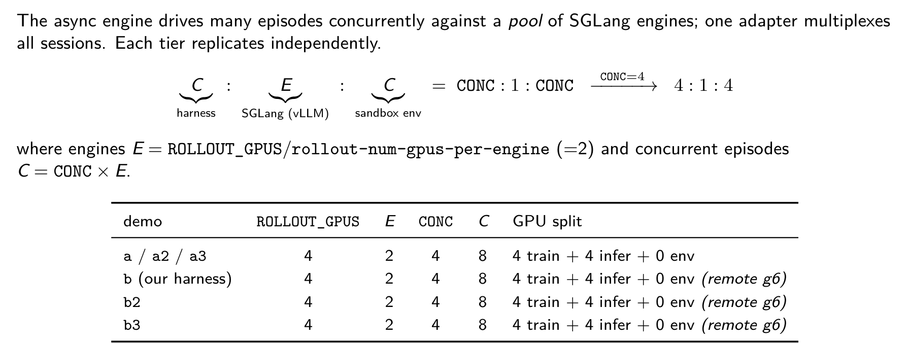{ width=72% }

Diagnose with `perf/sglang_gen_ms_*` vs `perf/sandbox_ms_*`, then replicate the slow tier only: inference-bound → more SGLang replicas; sandbox-bound → more concurrency/instances. The three tiers balance by **different** rules — a cache-aware router for inference, round-robin (sticky per episode) on the sandbox side.

# 7 · Open problems, summary, references

## Networking & isolation — private by default

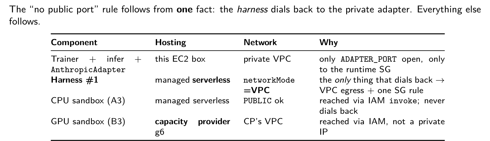{ width=70% }

Principle: **pull, don't expose.** Every Runtime is **reached** by a SigV4 `invoke_agent_runtime` — **no inbound port**. Only dial-back (harness ← sandbox) needs ingress: **one** rule, tcp/`ADAPTER_PORT`, source = the *runtime SG* (never a CIDR), over `networkMode=VPC` [D10] — which then requires interface endpoints (`ecr.api`, `ecr.dkr`, `s3` gateway, `logs`, `sts`, `bedrock-agentcore`) [D11]; miss one, or land an ENI in an unserved AZ, and create fails with a **null reason**.

## Open problems in production agentic RL

**Infrastructure/systems.** Long-tail stragglers & partial rollouts (generation > 90% of runtime; APRIL/AReaL) · weight-sync cost & **staleness** (this project accepts it — `MODE=B` async) · goodput vs MFU (measured **2–4%** MFU — the RL norm) · **scaling sandboxes to 10k+** (Kimi K2 [5] — exactly AgentCore's seam) · cache-aware routing · fault tolerance (the two resilience demos).

**Algorithms.** Train/inference logprob mismatch → **TIS** (TITO fixes the tokenization half only) · **GRPO** failure modes → DAPO / GSPO / Dr. GRPO · long-horizon **credit assignment** (turn-level, GiGPO) · reward hacking / verifier trust (binary RLVR sidesteps neural-RM hacking) · entropy collapse · curriculum & discard ratio.

*Open work concentrates in three places: record the off-policy signals (staleness, IS ratio, discard ratio) + add TIS; move GRPO → DAPO/GSPO as scale grows; turn-level credit for long-horizon families.*

## Summary — can, cannot, how to run

- **Can:** isolated per-session sandbox for untrusted output (CPU default), in-account (IAM/SigV4, VPC), long sessions, BYO container, **GPU on Instances**, and a clean one-hook slime integration with the harness in-process.
- **Cannot:** microVM GPU; cross-session GPU fractioning (no MIG on L4); exceed the microVM 8 h cap without Instances (14 d).
- **How to run:** build a sandbox image → deploy a Runtime / GPU capacity provider → seed a task → `invoke_agent_runtime` per tool call → the in-sandbox checker gives the reward → slime trains via one `generate` hook. **CPU↔GPU is one env var.**
- **Proven:** 2 convergence curves + loop-verified smokes for 12 of the 13 demos (15 CPU + 6 GPU runs) on real hardware; warm-reuse m5 boots 201 → 1. Caveats: `demo_cpu_branching` reward 0; fractional GPU farm on local L40S.

## References — papers & models

```{=latex}
\footnotesize
```

**Agentic RL & models.** [1] Agent Lightning. <https://arxiv.org/abs/2508.03680> · [2] DeepSeek-R1. <https://arxiv.org/abs/2501.12948> · [3] Qwen3. <https://arxiv.org/abs/2505.09388> · [4] Llama-Nemotron. <https://arxiv.org/abs/2505.00949> · [5] Kimi K2. <https://arxiv.org/abs/2507.20534> · [6] SWE-bench. <https://arxiv.org/abs/2310.06770> · [7] KernelBench. <https://huggingface.co/datasets/ScalingIntelligence/KernelBench> · [8] MBPP. <https://arxiv.org/abs/2108.07732> · [9] slime. <https://github.com/THUDM/slime>

## References — AgentCore docs (1/2)

```{=latex}
\scriptsize
```

**Official AgentCore docs.** [D1] What is AgentCore. <https://docs.aws.amazon.com/bedrock-agentcore/latest/devguide/what-is-bedrock-agentcore.html> · [D2] Host with Runtime. <https://docs.aws.amazon.com/bedrock-agentcore/latest/devguide/agents-tools-runtime.html> · [D3] Runtime how it works (idle 15 m / max 8 h). <https://docs.aws.amazon.com/bedrock-agentcore/latest/devguide/runtime-how-it-works.html> · [D4] Lifecycle settings. <https://docs.aws.amazon.com/bedrock-agentcore/latest/devguide/runtime-lifecycle-settings.html> · [D5] Instances (GPU). <https://docs.aws.amazon.com/bedrock-agentcore/latest/devguide/runtime-instances-how-it-works.html> · [D6] Code Interpreter. <https://docs.aws.amazon.com/bedrock-agentcore/latest/devguide/code-interpreter-tool.html> · [D7] Code Interpreter session. <https://docs.aws.amazon.com/bedrock-agentcore/latest/devguide/code-interpreter-session-characteristics.html>

## References — AgentCore docs (2/2)

```{=latex}
\scriptsize
```

[D8] InvokeAgentRuntime. <https://docs.aws.amazon.com/bedrock-agentcore/latest/APIReference/API_InvokeAgentRuntime.html> · [D9] CreateAgentRuntime. <https://docs.aws.amazon.com/bedrock-agentcore-control/latest/APIReference/API_CreateAgentRuntime.html> · [D10] NetworkConfiguration. <https://docs.aws.amazon.com/bedrock-agentcore-control/latest/APIReference/API_NetworkConfiguration.html> · [D11] VPC interface endpoints. <https://docs.aws.amazon.com/bedrock-agentcore/latest/devguide/vpc-interface-endpoints.html> · [D12] StopRuntimeSession. <https://docs.aws.amazon.com/bedrock-agentcore/latest/APIReference/API_StopRuntimeSession.html> · [D13] Observability. <https://docs.aws.amazon.com/bedrock-agentcore/latest/devguide/observability.html>

---

*Thank you — Questions?*
